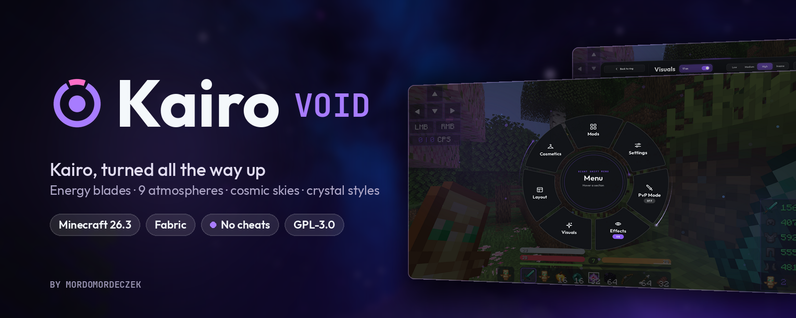
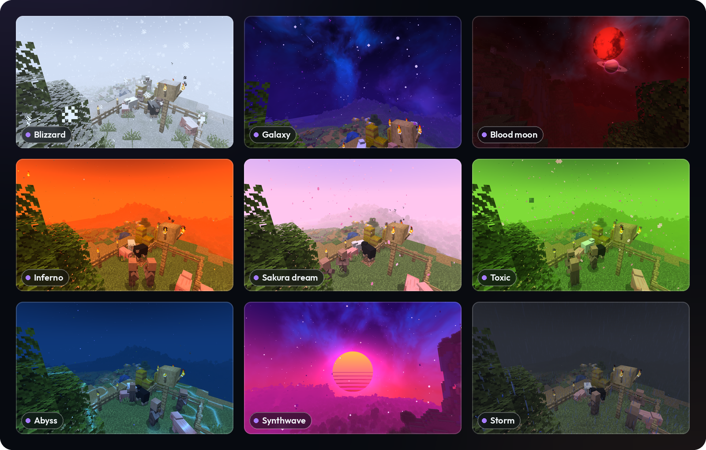
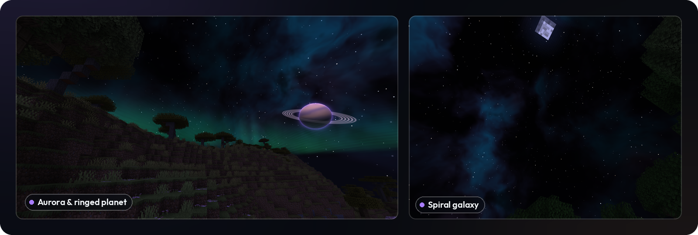
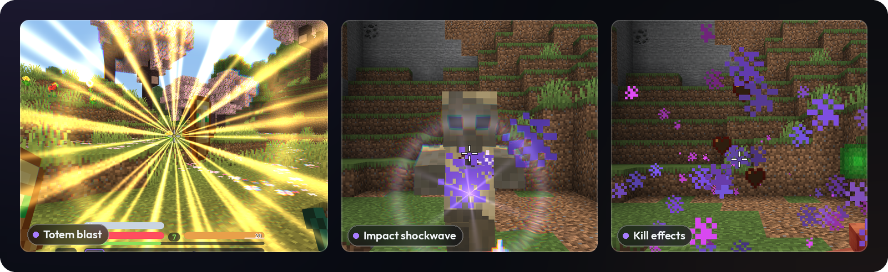
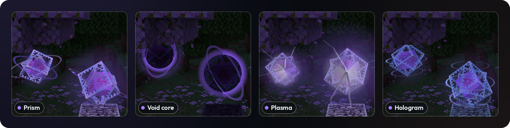
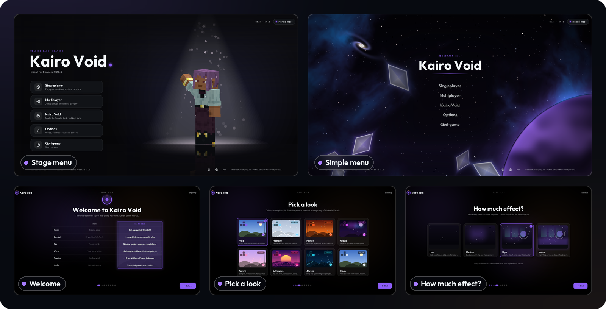
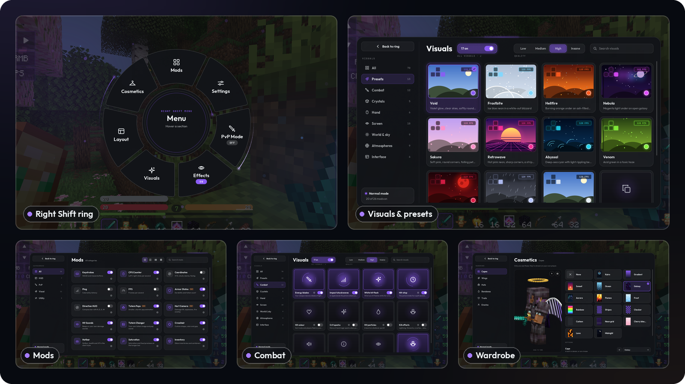
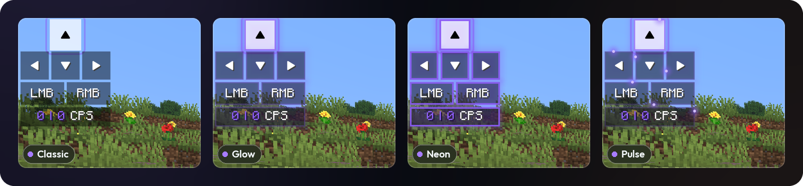

  

  
  
  
  
  

  <b>Everything <a href="https://github.com/MordoMordeczek/Kairo">Kairo</a> has, plus energy blades, impact shockwaves, nine atmospheres, a cosmic night sky and glowing crystals.</b> 
  Flat dark menus with one accent colour. Still visual and client-side only: no cheats, nothing extra sent to servers.

  <a href="https://github.com/MordoMordeczek/KairoVoid/releases/latest"><b>Download</b></a> ·
  <a href="#-install"><b>Install</b></a> ·
  <a href="https://mordomordeczek.github.io/Kairo/#void"><b>Website</b></a> ·
  <a href="https://github.com/MordoMordeczek/Kairo"><b>Kairo</b></a> ·
  <a href="https://github.com/MordoMordeczek/Kairo/blob/main/docs/FEATURES.md#kairo-void"><b>Feature guide</b></a>

 

|  |  |  |
|:--|:--|:--|
| ⚡ **Over-the-top combat** Energy blades on your weapon, shockwaves where hits land, hit-stop and a totem blast. | 🌌 **A sky worth looking at** Nebulae, a spiral galaxy, a ringed planet, aurora and nine full atmospheres. | 🎚️ **One switch away from vanilla** Low to Insane presets, and **J** turns every visual off and back on. |

## ✦ Atmospheres

Each one changes the sky, fog and colours and brings its own weather: snow that settles on blocks, falling petals, rain and lightning. Only on your screen.

## ✦ The night sky

At night: a nebula band, a turning spiral galaxy, a ringed planet, twinkling and shooting stars, and aurora curtains in the north. Deeper sunrises and sunsets, and distant land fading into a sky-coloured haze.

## ✦ Combat

Your weapon glows with energy when you swing and leaves a streak of light, brighter on crits. A ripple bends the picture where your hit lands, what you hit flashes white, and the picture holds for a split second on strong hits (only the picture; the game keeps running). Golden rays when a totem saves you.

## ✦ Crystals

End crystals as **Prism**, **Void core**, **Plasma** or **Hologram**, with a pop of light, a ring and a ripple when one explodes.

## ✦ Menus, presets and HUD

Two Void main menus: **Stage** (your player in a spotlight on a glossy floor, with an emote now and then) and **Simple**, over a drawn space scene. Eleven presets set a whole look in one click (Void, Frostbite, Hellfire, Nebula, Sakura, Retrowave, Abyssal, Venom, Bloodline, Thunder, Clean), and the first-run setup also asks how much effect you want, from Low to Insane.

HUD boxes can glow, go neon or pulse with a light running round them:

Plus everything from Kairo: 25+ mods, the drag-and-drop HUD editor, PvP mode, cosmetics and 37 emotes. See the [Kairo page](https://github.com/MordoMordeczek/Kairo) for those.

## 📦 Install

1. Install [Fabric Loader](https://fabricmc.net/use/) for Minecraft Java **26.3**.
2. Put these in your `mods` folder:
   - [Fabric API](https://modrinth.com/mod/fabric-api) for 26.3
   - [Sodium](https://modrinth.com/mod/sodium) 0.9.x for 26.3 (required)
   - `kairo-void-0.1.0.jar` from [Releases](https://github.com/MordoMordeczek/KairoVoid/releases/latest)
3. Start the game. A short setup runs the first time. In game, press **Right Shift**.

**Kairo or Kairo Void, not both.** They use the same mod id. Void keeps its own settings in `config/kairo-void`.

Tested on Windows.

> [!WARNING]
> **Photosensitivity.** Kairo Void has a *lot* of flashing lights, bright bursts of colour, screen shakes and fast-moving effects. A very small number of people can have a seizure when they see flashing lights or patterns, even with no history of epilepsy. If you or anyone in your family has had seizures or epilepsy, talk to a doctor before playing, and stop right away if you feel dizzy or sick or notice blurred vision, twitches or confusion. The first-run setup lets you pick **Fewer flashes** and **Reduce motion**, and a lower effect preset; all of them can be changed any time in *Visuals*.

## 🛡️ Fair play and privacy

- **No cheats.** Void only changes what your own screen draws and plays. No automation, no packet changes, no reach, no ESP.
- **No internet.** No accounts, no telemetry, no analytics.
- **Server rules still apply.** Some servers have rules about client mods. Check them before you play.

## 🔨 Source code

Kairo Void is built from the same code as Kairo, which lives in the [Kairo repository](https://github.com/MordoMordeczek/Kairo). `./gradlew build` there makes both jars; `./gradlew runVoidClient` runs Void in a dev client.

## 🤖 Certified AI slop

Kairo Void is **100% vibecoded**, just like its sibling. I had the ideas, picked the colours and stared at a lot of galaxies; the AI wrote the code, the shaders and this README. If the sky looks too good, blame the vibes.

## 📄 License

Kairo Void is free software under the [GNU General Public License v3.0](LICENSE). Copyright © 2026 MordoMordeczek. The bundled fonts (Outfit, JetBrains Mono) are under the SIL Open Font License; see [THIRD_PARTY_NOTICES.md](THIRD_PARTY_NOTICES.md).

Not an official Minecraft product. Not approved by or associated with Mojang or Microsoft. Minecraft is a trademark of Mojang Synergies AB. Fabric and Sodium are separate projects with their own licences and are never bundled.
